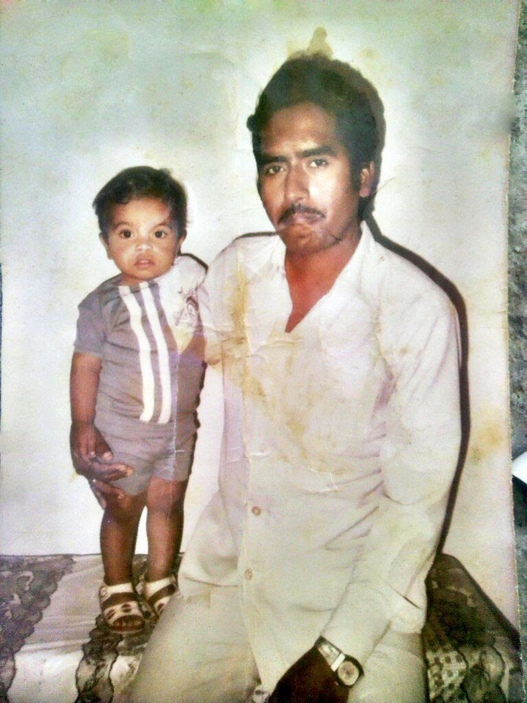

A ship set sail on a new sea, with a destination unknown. Carrying on it, a cargo dear to me. Across the river and into a world that might not be. Gone away, never to come back. To find his peace with that world, having given it up on this.

And I was left on this shore. Left behind. Left alone, waving goodbye. Left waving goodbye ...

<i>Inna lillahi wa inna ilayhi raji'un</i>

